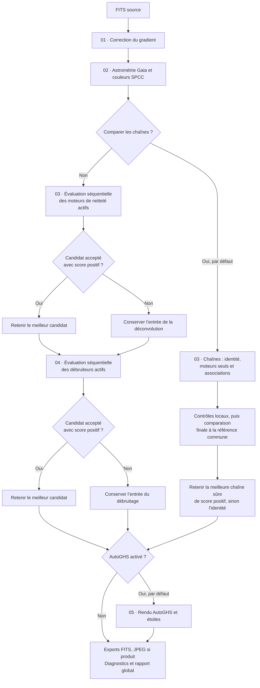

# postProcess — post-traitement d’une image FITS

[Documentation](../../README.md) › [Scripts](../README.md) › postProcess

`bin/postProcess.py` traite une image FITS dans cet ordre :
**correction du gradient → étalonnage spectrophotométrique → comparaison des chaînes complètes de restauration**.
Chaque étape reçoit l’image retenue par la précédente et produit un rapport JSON.
La [qualité astrophotographique](quality.md) utilise par défaut des masques fixes,
des mesures de bruit avec incertitude et des diagnostics du signal diffus.
`--quality-mode legacy --no-restoration-compare-chains` retrouve les métriques
historiques et les comparaisons par étape.
La comparaison des chaînes débruitage → netteté est active par défaut ;
l’ordre inverse reste optionnel. `--no-restoration-compare-chains` rétablit
les comparaisons par étape, déconvolution puis débruitage. Voir la
[synthèse des essais et des éliminations](quality.md#synthèse-des-essais-et-des-éliminations).
Les cinq traitements sont activés par défaut ; leur activation peut être
modifiée par la ligne de commande ou par la configuration mémorisée.

Cette commande s’utilise séparément sur un résultat de stacking ou une mosaïque,
ou s’enchaîne dans [lightProcess](../lightProcess/README.md) avec `--postprocess`.
Les deux entrées utilisent le même
[processeur complet et ses paramètres](pipeline.md). Elle ne réalise ni
la calibration des poses brutes, ni leur empilement. Le
[rendu final AutoGHS](auto-ghs.md) est exécuté après la restauration :
il sépare les étoiles avec StarNet et produit une image finale étoilée RANGE,
en FITS et [JPEG](render-exports.md), avec ses histogrammes de diagnostic.
Il est activé par défaut ; `--disable-autoghs` conserve la sortie linéaire.

Une [passe couleur finale facultative](final-color.md) peut suivre GHS avant
la fusion et l'annotation : `--enable-final-color` l'active et `--color-only`
permet de la relancer seule sur les couches GHS existantes.

GraXpert est ajouté automatiquement à la comparaison lorsque des poids locaux
valides sont présents, sauf désactivation explicite (`--no-enable-graxpert` ou
configuration sauvegardée). ONNX Runtime s’installe avec
`bin/postProcess.sh --install-graxpert`. `--enable-graxpert` force l’activation et
l’acquisition des poids manquants ; voir [GraXpert et ses modèles](graxpert.md).

<a id="manuel-d-utilisation"></a>
<a id="manuel-dutilisation"></a>

## 1. Manuel d’utilisation

<a id="lancer-un-traitement"></a>

### 1.1. Lancer un traitement

Le script demande automatiquement le profil performance et inhibe la veille
pendant le calcul. Cette [protection énergétique](power-guard.md) est facultative :
si D-Bus ou ses services sont indisponibles, le traitement continue normalement.

Depuis la racine du projet :

```bash
bin/postProcess.sh image_RGB.fit rapports/ \
  --photometry-object M20
```

Le premier argument est le FITS d’entrée. Le second, facultatif, choisit le
**répertoire de sortie** (un ancien chemin de rapport JSON reste accepté et son
dossier parent est utilisé). Sans cet argument, les sorties sont écrites à côté
du fichier source.

Chaque exécution crée un nom de base `<image>_postprocess` :

- dossier d’étapes et d’artefacts intermédiaires :
  `<image>_postprocess/`
- rapport global : `<image>_postprocess.json`
- FITS final : `<image>_postprocess.fits`
- JPEG final si AutoGHS est actif : `<image>_postprocess.jpg`

Le rapport global et le FITS final sont donc au même niveau que le dossier
d’étapes et partagent son nom de base.

Avec la [couleur finale](final-color.md) activée, le rendu GHS est conservé
dans `<image>_postprocess_ghs.fits/.jpg` et le résultat saturé porte le nom
`<image>_postprocess_saturated.fits/.jpg`. Son annotation est
`<image>_postprocess_saturated_annotated.png`.

Le wrapper conserve le dossier de lancement pour résoudre les chemins relatifs.
L’appel Python équivalent, avec le venv déjà activé, est :

```bash
python bin/postProcess.py image_RGB.fit rapports/
bin/postProcess.sh --help
```

Les étapes utilisant Siril génèrent des scripts exigeant **Siril 1.4 au minimum**.
L’entrée de la séquence complète doit être une image **RGB linéaire déjà
dématricée**, nécessaire à la photométrie. Le débruitage et la déconvolution
acceptent aussi les images monochromes, mais refusent une image CFA encore
identifiée par `BAYERPAT`. Pour une image monochrome, désactiver la photométrie et AutoGHS.
La recherche d’objet au CDS et les catalogues distants nécessitent un accès réseau.
Voir [l’installation](../../INSTALLATION.md) pour l’environnement du projet.

<a id="ordre-et-circulation-des-images"></a>

### 1.2. Ordre et circulation des images



Le schéma décrit le mode `reliable`, avec les traitements linéaires actifs
et le rendu AutoGHS facultatif, activé par défaut.
Siril et Cosmic Clarity produisent les candidats de netteté ; GraXpert peut
s’ajouter au débruitage. Les activations des moteurs sont respectées.
Une étape désactivée transmet l’image courante à la suivante. En mode fiable,
une erreur technique d’un moteur est auditée, puis les autres sont essayés.
Les erreurs de gradient, photométrie ou de publication restent bloquantes.
Un échec du rendu AutoGHS est également bloquant. En comparaison de chaînes,
les associations suivent par défaut l’ordre débruitage puis netteté ; l’ordre
inverse s’ajoute avec `--restoration-reverse-order`. Dans la branche par étapes
isolées, la netteté précède toujours le débruitage.
Un refus de qualité conserve l’entrée et permet de poursuivre. Le mode
`legacy` conserve les exceptions bloquantes historiques des moteurs et peut
retenir un candidat accepté même si son score n’est pas positif.

| Position | Traitement | Classe | Effet sur l’image |
|---|---|---|---|
| 01 | `gradient` | `GradientExtractor` | Soustrait les variations du fond |
| 02 | `photometry` | `PhotometricColorCalibrator` | Résout l’astrométrie et étalonne les couleurs |
| 03 | `deconvolution` | `DeconvolutionProcessor` (orchestrateur) | Améliore la finesse avec contrôle des étoiles et des artefacts |
| 04 | `denoise` | `NoiseReductionProcessor` (orchestrateur) | Réduit le bruit si les contrôles de qualité sont satisfaits |

Les indices restent fixes lorsqu’une étape est désactivée. Les options
`--enable-gradient`, `--enable-photometry`, `--enable-denoise` et
`--enable-deconvolution` activent explicitement les étapes correspondantes ; les
options `--disable-…` les désactivent. Les variantes `--enable_<préfixe>` et
`--disable_<préfixe>` sont également acceptées. Hors comparaison des chaînes,
leur ordre reste fixe. La comparaison des chaînes, active par défaut, remplace les étapes 03/04
par `03_restoration`, en respectant leurs activations ; voir les
[chaînes complètes](quality.md#chaînes-complètes).

<a id="utiliser-seulement-certaines-tapes"></a>
<a id="utiliser-seulement-certaines-étapes"></a>

### 1.3. Utiliser seulement certaines étapes

```bash
# Image monochrome : pas d’étalonnage photométrique RGB.
bin/postProcess.sh image_mono.fit rapports/mono.json --disable-photometry --disable-autoghs

# Photométrie seule, avec une focale et une taille de pixel données en exemple.
bin/postProcess.sh image_RGB.fit rapports/couleurs.json \
  --disable-gradient --enable-photometry --disable-denoise --disable-deconvolution --disable-autoghs \
  --photometry-object M20 --photometry-focal 750 --photometry-pixelsize 3.76

# Débruitage seul, sans modifier les réglages mémorisés.
bin/postProcess.sh image.fit rapports/bruit.json \
  --disable-gradient --disable-photometry --enable-denoise --disable-deconvolution --disable-autoghs

# Déconvolution seule avec PSF stellaire et repli adaptatif autorisé.
bin/postProcess.sh image.fit rapports/details.json \
  --disable-gradient --disable-photometry --disable-denoise --enable-deconvolution --disable-autoghs \
  --deconvolution-psf-method stars --deconvolution-adaptive
```

Pour l’utilisation Python et l’ajout d’un traitement, consulter
[le contrat de la séquence](../lightProcess/treatments/postprocess/SEQUENCE_PROCESSOR.md).

Le lanceur utilise Python et pip du système pour créer le venv sans pip et
mettre à jour ses dépendances avant chaque exécution. Il lance ensuite le
Python du venv. La sélection de l’environnement, les prérequis et l’exécution
sans mise à jour sont décrits dans [Installation](../../INSTALLATION.md).

Les classes des traitements sont enregistrées avant le parsing. Les valeurs
résolues sont ensuite liées aux classes avant la création des instances, y
compris les enfants. Voir la [liaison des paramètres](../lightProcess/treatments/postprocess/SEQUENCE_PROCESSOR.md#résolution-et-liaison-hiérarchique-des-paramètres).

Les poids Cosmic Clarity manquants ou corrompus sont téléchargés avant leur
chargement dans `tmp/models/cosmicclarity/` par défaut, ou dans le dossier
`--cosmic-model-dir` résolu. Voir [installation et téléchargement](cosmic-clarity.md#installation-et-lancement).

En mode `--quality-mode legacy`, pour la netteté Cosmic Clarity, les grands catalogues sont contrôlés selon la
[représentativité spatiale et en flux](cosmic-clarity.md#matching-representation),
avec une alerte de fraction au lieu du rejet automatique à 70 %.

Les journaux détaillent les mesures, seuils et verdicts de chaque contrôle ; voir
[la lecture des motifs](cosmic-clarity.md#lecture-des-motifs-dans-le-journal).

La [mesure aux positions initiales](reference-stars.md) est activée par défaut
pour comparer les candidats Siril, Cosmic Clarity et GraXpert. Les moteurs Siril
et Clarity acceptent `--no-deconvolution-reference-measurements` pour rétablir
les catalogues indépendants ; GraXpert et les contrôles finaux des chaînes
conservent les mesures aux positions initiales. Le diagnostic conserve le SNR
et les motifs d’échec individuels.

La [structure des traitements de restauration](restoration.md) distingue les
orchestrateurs des moteurs Siril, Cosmic Clarity et GraXpert, tous de type `processor`.

Les moteurs Siril organisent leur calcul en [phases d’exécution indépendantes](restoration.md#siril-execution-phases), avec un état propre à chaque appel. L’élargissement de la PSF ne modifie pas le seuil d’appariement configuré.

Le [rendu final AutoGHS](auto-ghs.md) termine cette séquence par défaut.
Voir aussi son [moteur et ses histogrammes](auto-ghs-algorithm.md) et le
[traitement séparé des étoiles](star-rendering.md). Une panne de cette phase
est fatale, sans reprise automatique ni substitution de rendu.

<a id="options-et-configuration"></a>
<a id="configuration-et-m-morisation"></a>
<a id="configuration-et-mémorisation"></a>
<a id="choix-du-calcul-cpu-gpu"></a>
<a id="choix-du-calcul-cpugpu"></a>
<a id="options-des-traitements"></a>

## 2. Options et configuration

Consulter la [référence des options de postProcess](OPTIONS.md). Les tableaux et réglages y sont regroupés.


<a id="traitements-d-taill-s"></a>
<a id="traitements-détaillés"></a>

## 3. Traitements détaillés

<a id="moteur-cosmic-clarity-optionnel"></a>

### 3.1. Moteur Cosmic Clarity optionnel

Cosmic Clarity et Siril sont activés par défaut. Chaque étape de restauration
évalue séquentiellement ses moteurs actifs sur la même entrée : deux moteurs
de netteté et jusqu’à trois débruiteurs avec GraXpert. `--disable-clarity`
désactive Cosmic Clarity ; `--no-restoration-siril` écarte Siril en mode fiable.
Pour utiliser uniquement le moteur Siril, désactiver aussi GraXpert avec
`--no-enable-graxpert`.
Si aucune déconvolution n’est acceptée, le statut reste
`no_safe_improvement` et l’image reçue est conservée. Si aucun débruitage n’est
accepté, l’image reçue est également conservée.

Algorithme appliqué en mode comparatif :

1. exécution séquentielle des moteurs actifs ;
2. contrôles de qualité sur chaque candidat, avec mêmes références stellaires
   et mêmes masques de ciel en mode fiable ;
3. conservation des seuls candidats `accepted` ;
4. calcul d’un score interne par candidat (netteté ou débruitage) ;
5. en mode fiable, sélection du score maximal strictement positif, sinon
   conservation de l’image d’entrée.

```bash
bin/postProcess.sh --install-cosmic-clarity
bin/postProcess.sh image_RGB.fit --enable-clarity
bin/postProcess.sh image_RGB.fit --disable-clarity --no-enable-graxpert
```

L'option d'installation est capturée par le `.sh` ; elle utilise pip système
pour installer les dépendances dans le venv et récupérer les poids vérifiés.
`--enable-clarity` et `--disable-clarity` appartiennent au programme Python et
peuvent être mémorisées avec `-S`.
Les noms des rapports, l'ordre et les contrôles d'acceptation restent les mêmes.
Les algorithmes détaillés ci-dessous décrivent le moteur Siril.
Quand Clarity est actif, un candidat Cosmic Clarity est ajouté à chaque étape
de restauration. GraXpert ajoute son propre candidat de débruitage lorsque ses
poids sont présents ou que son activation est forcée.
Voir [Cosmic Clarity](cosmic-clarity.md) pour les classes, modèles, paramètres,
ressources, différences avec l'amont et limites de validation.

<a id="01-correction-du-gradient"></a>

### 3.2. Correction du gradient (étape 01)

Le gradient est une variation lente du fond de ciel. Le traitement estime ce
fond puis soustrait ses variations **en conservant son niveau au centre de
l’image**. Il travaille séparément sur chaque canal, produit un FITS flottant
et conserve les métadonnées WCS et les extensions FITS.

Deux méthodes sont disponibles :

- **RBF**, par défaut : mesure des médianes locales sur une grille, rejet des
  cellules trop brillantes, puis interpolation avec SciPy. Le lissage règle
  la régularisation du modèle de fond.
- **Polynomiale** : analyse plusieurs degrés pour en recommander un, puis ajuste
  ce degré séparément sur chaque canal avec rejet des valeurs aberrantes.

Le PNG facultatif des points de mesure permet d’inspecter l’échantillonnage du
fond. Les grandes nébulosités peuvent influencer l’estimation : comparer le
résultat au FITS d’entrée avant de retenir le réglage.

| Option | Défaut local | Rôle |
|---|---|---|
| `--gradient-method` | `rbf` | `rbf` ou `polynomial` |
| `--gradient-smoothing` | `0.5` | Lissage RBF, de 0 à 1 |
| `--gradient-samples-per-line` | `20` | Densité de la grille RBF |
| `--gradient-grid-tolerance` | `2.0` | Seuil de rejet des cellules brillantes, en sigma robuste |
| `--gradient-keep-all-samples` | désactivé | Conserver aussi les cellules brillantes ; inverse : `--no-gradient-keep-all-samples` |
| `--gradient-min-order` / `--gradient-max-order` | `1` / `3` | Degrés testés en mode polynomial, entre 1 et 5 |
| `--gradient-sample-fraction` | `0.3` | Fraction des pixels ajustés en mode polynomial |
| `--gradient-max-samples` | `10000` | Nombre maximal de pixels ajustés en mode polynomial |
| `--gradient-points` | `100` | Nombre de points affichés pour l’analyse polynomiale |
| `--gradient-measurement-image` | activé | PNG de contrôle ; désactiver avec `--no-gradient-measurement-image` |
| `--gradient-output` | dossier du rapport individuel | Répertoire du FITS corrigé et des aperçus |

Pour ne lancer que cette étape :

```bash
bin/postProcess.sh image.fit rapports/gradient.json \
  --enable-gradient --disable-photometry --disable-denoise --disable-deconvolution --disable-autoghs \
  --gradient-method polynomial --gradient-max-order 2
```

Ce traitement utilise Python et ne lance pas Siril.

<a id="02-astrom-trie-et-talonnage-spectrophotom-trique"></a>
<a id="02-astrométrie-et-étalonnage-spectrophotométrique"></a>

### 3.3. Astrométrie et étalonnage spectrophotométrique (étape 02)

Sur une image RGB linéaire, le traitement appelle successivement `platesolve`
puis `spcc` dans Siril, avec **Gaia par défaut pour les deux commandes**.
L’astrométrie associe les pixels à des coordonnées célestes ; SPCC utilise les
spectres stellaires Gaia DR3 et les réponses spectrales du capteur et des filtres
pour étalonner les couleurs. `--photometry-method pcc` permet de choisir PCC.
Les profils SPCC non précisés sont repris des préférences Siril, sauf le filtre
OSC : option du programme, puis champ `FILTER` du FITS, sinon `No filter`.
Vérifier que les profils correspondent à l’acquisition. Voir [SPCC, profils et orientation](photometry.md).

Le centre du champ peut être donné par un nom d’objet recherché au CDS ou par
ses coordonnées ICRS/J2000 en degrés. Ces deux options sont exclusives. Sans
centre explicite, Siril utilise les informations disponibles dans l’image et
ses réglages. L’astrométrie est toujours recalculée même si un WCS existe,
avec retournement autorisé par Siril. L’étalonnage des couleurs est ensuite
exécuté à chaque lancement de l’étape, même si l’image a déjà été étalonnée.

| Option | Rôle ; défaut local si non précisé |
|---|---|
| `--photometry-object NOM` | Recherche au CDS ; aucun objet par défaut |
| `--photometry-coordinates RA DEC` | Centre en degrés ; RA dans `[0, 360[`, DEC dans `[-90, 90]` |
| `--photometry-focal MM` | Focale ; sinon métadonnées/réglages Siril |
| `--photometry-pixelsize UM` | Taille effective du pixel ; tenir compte du binning et du rééchantillonnage |
| `--photometry-force` | Option de compatibilité ; la résolution est systématiquement refaite |
| `--photometry-noflip` | Conserver l’orientation pendant la résolution, désactivé par défaut |
| `--photometry-downscale` | Sous-échantillonner pour la résolution, désactivé par défaut |
| `--photometry-method` | `spcc` (défaut) ou `pcc` |
| `--photometry-osc-sensor` / `--photometry-mono-sensor` | Nom exact du capteur SPCC ; options exclusives, sinon préférences Siril |
| `--photometry-osc-filter` / `--photometry-osc-lpf` | Filtre OSC : option, puis FITS `FILTER`, sinon `No filter` ; passe-bas : sinon préférences Siril |
| `--photometry-red-filter` / `--photometry-green-filter` / `--photometry-blue-filter` | Filtres du RGB composé avec un capteur mono ; sinon préférences Siril |
| `--photometry-white-reference` | Référence de blanc SPCC ; sinon préférences Siril |
| `--photometry-solve-catalog` | `tycho2`, `nomad`, `localgaia`, `gaia`, `ppmxl`, `brightstars` ou `apass` ; défaut `gaia` |
| `--photometry-catalog` | Défaut `gaia` ; SPCC accepte `gaia` ou `localgaia`, PCC accepte aussi `nomad` et `apass` |
| `--photometry-limitmag` | Magnitude limite positive pour SPCC/PCC ; non imposée par défaut |
| `--photometry-output` | FITS étalonné ; par défaut `02_photometry.fits` dans le dossier des étapes |

Le résultat n’est publié qu’après réussite de Siril et vérification des dimensions
et de la présence d’un WCS céleste. Le rapport conserve les coordonnées utilisées,
la méthode, les catalogues, les profils transmis et la provenance du filtre, les commandes,
les chemins du script et du journal, ainsi que `output_image`. Il indique aussi
si un WCS existait, si une résolution était demandée et si un retournement était
autorisé. `--photometry-noflip` empêche le retournement lors de la résolution ;
il ne tourne pas l’image vers le nord. SPCC ne réoriente pas l’image.

<a id="03-d-convolution-contr-l-e"></a>
<a id="03-déconvolution-contrôlée"></a>

### 3.4. Déconvolution contrôlée (étape 03 en mode séparé)

La déconvolution cherche à réduire l’étalement des détails. Elle utilise
Richardson–Lucy par descente de gradient avec régularisation TV, sur une copie
de l’image reçue. La PSF est le noyau représentant cet étalement.

Ce paragraphe décrit le traitement **Siril** ; en mode comparatif, le candidat
**Cosmic Clarity** est évalué séparément et séquentiellement, puis soumis aux
mêmes contrôles d’acceptation.

Par défaut, la PSF est estimée par Siril avec `makepsf blind -l0`. L’option
`--deconvolution-psf-method stars` utilise une sélection d’étoiles fines, rondes
et isolées. Le premier essai emploie 10 itérations et un pas de `0.0003`.

L’acceptation repose sur les mêmes étoiles avant et après : au moins 10 paires et
70 % des étoiles valides retrouvées par défaut. Il faut un gain d’au moins 2 %
sur la FWHM moyenne et le ratio médian apparié, sans perte de rondeur moyenne
supérieure à `0.01`. Le bruit ne doit pas dépasser 1,15 fois son niveau initial,
et la fraction de nouveaux anneaux ne doit pas dépasser 10 %. Les contrôles
d’artefacts portent sur tous les canaux.
Le bruit est mesuré sur les masques fixes décrits dans
[Qualité astrophotographique](quality.md). Un bruit `UNKNOWN` n’est pas validé,
mais n’interdit pas à lui seul une amélioration stellaire en déconvolution.
Des anneaux impossibles à mesurer rejettent le candidat. Les nouveaux contrôles
de flux sont diagnostiques, sauf activation de `--quality-enforce-diffuse`.

#### Détail du candidat Cosmic Clarity (mode comparatif)

Les modes suivent ceux de l’auteur : luminance par défaut pour la netteté et
le débruitage, avec options R/V/B séparés et débruitage de chrominance.
Voir [modes couleur Cosmic Clarity](cosmic-color.md) pour les options et les
limites de conservation des couleurs.


En mode comparatif, l’étape produit aussi un candidat neuronal :

- application du modèle stellaire puis des modèles non stellaires
  (interpolation sur le rayon `--cosmic-nonstellar-radius`) ;
- mélange entrée/prédiction selon `--cosmic-stellar-amount` et
  `--cosmic-nonstellar-amount` ;
- écriture d’un candidat FITS dédié, puis mesures Siril avant/après sur le même
  canal (`--deconvolution-layer`) et appariement stellaire identique.

Le candidat Siril et le candidat Cosmic Clarity sont ensuite comparés :

- seuls les candidats au statut `accepted` sont éligibles ;
- un [score de netteté](cosmic-clarity.md#score-de-sélection-utilisé) est calculé
  pour chaque candidat accepté ;
- le candidat au score maximal devient `03_deconvolution.fits` ;
- si aucun candidat accepté ne bat l’identité en mode fiable, l’étape renvoie `no_safe_improvement` et
  conserve l’image d’entrée.

**Le repli adaptatif est activé par défaut.** Si le premier essai échoue, le
traitement commence avec le tiers central de chaque dimension de l’original.
Si la sélection contient moins de trois étoiles fines et isolées, la zone est
élargie à la moitié, aux deux tiers, puis au champ entier. Les critères stellaires
restent identiques. La première zone fournissant assez d’étoiles sert à construire
la PSF Moffat et à tester les pas
croissants de `0.0004` à `0.001` par défaut. Chaque essai repart du recadrage
original. La recherche s’arrête au premier échec des contrôles d’artefacts.
Le dernier pas accepté est appliqué au champ entier, qui doit à nouveau passer
les contrôles. Utiliser `--no-deconvolution-adaptive` pour forcer le mode simple.
Les essais sont numérotés dans le journal et dans `attempts[].number` du
rapport JSON. Une erreur locale de PSF (par exemple moins de trois étoiles
Moffat admissibles même sur le champ entier) est conservée dans l’audit et
invalide ce repli seulement. Les zones testées figurent dans
`adaptive_crop_attempts`, avec leurs dimensions et leur verdict ; le journal
indique chaque élargissement. Aucun essai de déconvolution ne précède la
construction réussie de cette PSF.
Une erreur d’exécution d’un essai laisse les pas suivants disponibles se
poursuivre ; un rejet pour artefacts arrête toujours la montée du pas.
En mode comparatif, le candidat Cosmic Clarity reste évalué et sélectionnable.
Pour les étapes de déconvolution et de débruitage, le journal `INFO` présente
les évaluations actives, leurs mesures et verdicts, les scores des candidats
acceptés puis le choix final. Voir le [détail du journal comparatif](cosmic-clarity.md#déroulé-comparatif-des-étapes-03-et-04).

Chaque moteur recrée son dossier de travail :
`03_deconvolution_siril_work/001/` ou
`03_deconvolution_cosmic_clarity_work/001/`. Le nom sans suffixe de moteur
(`03_deconvolution_work/001/`) concerne l’appel direct Siril historique en
mode `legacy`, sans Clarity. Cela évite les reliquats d’un lancement précédent.

| Option | Défaut local | Rôle |
|---|---|---|
| `--deconvolution-psf-method` | `blind` | PSF `blind` ou `stars` |
| `--deconvolution-iterations` | `10` | Nombre d’itérations, de 1 à 1000 |
| `--deconvolution-psf-size` | `15` | Taille impaire du noyau, entre 3 et 255 pixels |
| `--deconvolution-alpha` | `3000` | Régularisation TV ; valeur plus faible = régularisation plus forte |
| `--deconvolution-step` | `0.0003` | Pas du premier essai |
| `--deconvolution-adaptive` / `--no-deconvolution-adaptive` | activé | Activer/désactiver le repli central avec PSF Moffat |
| `--deconvolution-max-step` | `0.001` | Dernier pas de la recherche adaptative, incrément de `0.0001` |
| `--deconvolution-fine-quantile` | `0.35` | Fraction fine retenue pour la sélection stellaire de PSF |
| `--deconvolution-psf-roundness` | `0.8` | Rondeur minimale des étoiles de PSF |
| `--deconvolution-layer` | vert `1` en RGB, `0` en mono | Canal des mesures stellaires |
| `--deconvolution-match-radius` | `1.0` | Rayon d’appariement, en pixels |
| `--deconvolution-min-stars` | `10` | Nombre minimal de paires |
| `--deconvolution-min-match-fraction` | `0.7` | Fraction minimale retrouvée |
| `--deconvolution-min-gain` | `0.02` | Gain relatif minimal de finesse |
| `--deconvolution-max-noise` | `1.15` | Rapport maximal de bruit après/avant |
| `--deconvolution-max-rings` | `0.1` | Fraction maximale de nouveaux anneaux |
| `--deconvolution-output` | `03_deconvolution.fits` | FITS accepté, dans le dossier des étapes par défaut |

Si aucun essai n’est accepté, l’audit de déconvolution prend le statut
`no_safe_improvement` et la séquence continue avec l’image reçue par cette étape.
Le journal principal indique explicitement que la déconvolution n’a pas été
appliquée. Les essais et diagnostics sont conservés ; les contrôles quantitatifs
restent à compléter par l’inspection des images, notamment des étoiles brillantes
et des nébulosités.

<a id="04-r-duction-du-bruit"></a>
<a id="04-réduction-du-bruit"></a>

### 3.5. Réduction du bruit (étape 04 en mode séparé)

Le traitement utilise la commande Siril `denoise -vst`, avec transformation
stabilisatrice de variance Anscombe, en flottant 32 bits. Il compare les
catalogues stellaires avant et après sur les mêmes étoiles : canal vert pour
une image RGB, canal unique pour une image monochrome.

Ce paragraphe décrit le traitement **Siril**. Les candidats **Cosmic Clarity**
et **GraXpert**, lorsqu’ils sont actifs, sont évalués séparément et
séquentiellement, puis départagés automatiquement.

Le candidat est accepté seulement si les contrôles suivants sont satisfaits :

- au moins 10 étoiles appariées et 70 % des étoiles valides initiales retrouvées,
  dans un rayon d’un pixel ;
- augmentation de la FWHM moyenne et du ratio médian apparié limitée à 3 % par défaut ;
- perte de rondeur moyenne au plus égale à `0.01` ;
- diminution mesurée du bruit sur tous les canaux et fraction de nouveaux anneaux
  stellaires ne dépassant pas 10 %.

En mode fiable, le bruit utilise les masques fixes et l’incertitude bootstrap
de [Qualité astrophotographique](quality.md), avec `noise_unknown` si le ciel
fiable manque. Une baisse numérique ne suffit pas à la sélection : le score
doit rester positif après pénalités. `--quality-enforce-significance` exige
en plus le gain utile configuré, 5 % par défaut, avec sa significativité.
Les contrôles de flux restent en observation sauf `--quality-enforce-diffuse`.
Les anneaux non mesurables rejettent également le candidat.

#### Comparaison des candidats de débruitage

En mode comparatif, l’étape calcule aussi un candidat neuronal de débruitage
(`--cosmic-denoise-amount`, modèle AI3.6), puis applique les mêmes mesures
stellaires Siril et contrôles d’artefacts que pour Siril.
[GraXpert natif](graxpert.md) produit un troisième candidat lorsque ses poids
locaux sont valides ou que son activation est forcée, sauf désactivation explicite.
Chaque moteur recrée son
propre dossier `04_denoise_<moteur>_work/001/`. Le dossier sans suffixe
`04_denoise_work/001/` concerne le mode direct Siril historique, sans Clarity
ni GraXpert, avec `--quality-mode legacy`.

La sélection suit la même logique que pour la déconvolution :

- seuls les candidats `accepted` participent ;
- le [score de débruitage](cosmic-clarity.md#score-de-sélection-utilisé) utilise
  la borne conservative du gain de bruit en mode fiable ;
- le score maximal strictement positif est retenu et copié en `04_denoise.fits` ;
- sans candidat accepté de score positif, le rapport final de l’étape garde `status: "rejected"`
  et transmet l’image reçue à l’étape.

En mode `legacy`, le score utilise le ratio de bruit historique et l’identité
n’impose pas un score positif aux candidats acceptés.

| Option | Défaut local | Rôle |
|---|---|---|
| `--denoise-modulation` | `0.5` | Intensité du débruitage, entre 0 et 1 |
| `--denoise-max-blur` | `0.03` | Augmentation relative maximale de FWHM, entre 0 et 1 |

Si le candidat est accepté, `04_denoise.fits` devient le FITS final.
Sinon, le rapport indique `status: "rejected"`, détaille `rejection_reasons` et
renvoie l’image précédente dans `output_image`. Les candidats et diagnostics
restent disponibles dans les dossiers des moteurs. En mode fiable, un échec
technique Siril est audité et écarte ce candidat ; les autres moteurs continuent.

<a id="restauration-et-autoghs"></a>

### 3.6. Restauration et AutoGHS

Le mode par défaut compare les [chaînes complètes de restauration](restoration.md) avant le [rendu final AutoGHS](auto-ghs.md). Les [contrôles de qualité](quality.md) et les [exports](render-exports.md) possèdent leurs pages de référence.

<a id="r-sultats-et-journaux"></a>
<a id="résultats-et-journaux"></a>

<a id="relance-autoghs-seul"></a>

### 3.7. Relancer uniquement StarNet et AutoGHS

Reprendre **la même commande**, avec la même entrée, le même répertoire de
sortie et les mêmes options, en ajoutant seulement `--autoghs-only` :

```bash
# Traitement complet.
bin/postProcess.sh image_RGB.fits resultats/ --config reglages.json
# Reprise du rendu final, sans changer l'entrée ni les paramètres.
bin/postProcess.sh image_RGB.fits resultats/ --config reglages.json --autoghs-only
```

Le programme retrouve dans la provenance précédente le FITS linéaire réellement
reçu par AutoGHS (par exemple la sortie de restauration). Il ne repart ni de
l'entrée brute ni du rendu déjà étiré. Les paramètres sont résolus comme pour
un traitement complet : CLI > JSON > défauts ; les options non mémorisées doivent
donc être répétées dans la commande. Les options amont restent acceptées mais
ne provoquent aucun recalcul amont dans ce mode.

Cette option saute le gradient, la photométrie, la déconvolution, le débruitage,
les comparaisons de restauration et leurs aperçus de qualité. Elle active AutoGHS
et la saturation pour cet appel, même si la couleur est désactivée dans le JSON.
Ajouter `--disable-final-color` pour l'écarter explicitement. Les options `only`
indiquent le point de reprise : toutes les étapes suivantes sont ensuite exécutées.
StarNet est relancé, puis les rendus et annotations sont remplacés
aux emplacements habituels. Les étapes amont et leurs rapports sont conservés.
Les prérequis Siril/StarNet et les contrôles de linéarité restent identiques.
Le paramètre de reprise n'est jamais mémorisé avec `-S`.

Depuis `lightProcess`, ajouter de même `--autoghs-only` à la commande complète :
les sessions et le mode mosaïque restent identiques, mais la calibration, le
stacking et la mosaïque sont aussi sautés. Les produits finaux précédents sont
retrouvés avant de reprendre leur dernière partie. `--dry-run` vérifie les
références et annonce la reprise sans exécuter les traitements.

Un historique ou un intermédiaire manquant, une entrée modifiée ou une référence
non linéaire entraîne une erreur avant la remise à zéro d'AutoGHS. Les nouveaux
traitements conservent `<image>_postprocess_resume.json` (chemins, tailles et dates
des fichiers ; ce n'est pas un hash du contenu). Les rapports antérieurs sont
compatibles s'ils contiennent explicitement `autoghs.image_path`, sans pouvoir
vérifier rétroactivement l'intégrité des fichiers. Si le traitement précédent
n'a pas laissé de référence exploitable, refaire un traitement complet.

La [dernière passe protégée](ghs-highlight-protection.md) est active par défaut.
`--ghs-highlight-retention 0.95` renforce la conservation des nuances brillantes ;
`--ghs-final-mode fixed` permet de comparer l'ancienne courbe finale.

### 3.8. Annotation finale

Une dernière [étape d’annotation](annotations.md) produit par défaut un PNG avec
les noms des objets du champ et un encart de prise de vue en bas à gauche,
après le rendu AutoGHS.
Utiliser `--no-final-annotation` pour la désactiver.

## 4. Résultats et journaux

<a id="rapports-images-et-journaux"></a>

### 4.1. Rapports, images et journaux

En INFO, le début du post-traitement et chacune de ses étapes actives portent
un titre entre deux lignes de `=`. Ces [bandeaux de progression](pipeline.md#bandeaux-du-journal)
apparaissent aussi lors de l’enchaînement depuis lightProcess, dans la console
et le journal par image.

Pour `bin/postProcess.sh image_RGB.fit rapports/`, avec toutes les
étapes actives et acceptées, en mode fiable et avec les poids GraXpert présents :

```text
rapports/
├── image_RGB_postprocess.fits
├── image_RGB_postprocess.jpg
├── image_RGB_postprocess.json
└── image_RGB_postprocess/
    ├── 00_image_RGB_postProcess.log
    ├── 01_gradient.json
    ├── 01_gradient_image_RGB_gradient_corrected.fits
    ├── 01_gradient_image_RGB_measurement_points.png
    ├── 02_photometry.json
    ├── 02_photometry.fits
    ├── 02_photometry_work/001/
    ├── 03_restoration.json
    ├── 03_restoration.fits
    ├── 03_restoration_summary.txt
    ├── 03_restoration_work/
    ├── 05_autoghs.json
    └── 05_autoghs_work/
        ├── 001/separation_work/
        ├── 002_stars/
        ├── 003_ghs/
        │   └── 03_restoration_starless_ghs_range.fits
        ├── 004_recomposition/
        │   ├── 03_restoration_render_range.fits
        │   └── 03_restoration_render_range.jpg
        └── 005_diagnostics/
```

Cet arbre omet les copies FITS et audits propres à chaque moteur de restauration.
Un moteur absent ou désactivé ne produit pas tous les fichiers. Les rendus
AutoGHS portent le nom de leur image amont ; ici `03_restoration` puisque la
restauration a retenu un candidat. Le mode `--no-restoration-compare-chains`
produit à la place les étapes séparées `03_deconvolution` et `04_denoise`.

Les dossiers des moteurs conservent scripts `.sps`, journaux `.log`, catalogues
stellaires et images candidates. Ils sont déterministes et recréés à chaque
exécution ; pour la déconvolution Siril, ils contiennent aussi l’original de l’étape,
les PSF et leurs aperçus, ainsi que `matched_stars.csv` préfixé par le nom de
l’étape en cas de succès.

Par défaut, `03_restoration.json`, `03_restoration_summary.txt` et le dossier
`03_restoration_work/` remplacent les rapports des étapes 03/04. Ce dossier
contient directement `common_masks.fits`, les rapports numérotés des opérations et les
aperçus PNG des zones de qualité (`common_masks.png`, étoiles rouges, signal
diffus orange, zones incertaines bleues et tuiles de ciel retenues vertes), puis les
contrôles finaux. `03_restoration.fits` est publié si une chaîne bat l’identité ;
sinon, l’image amont est conservée. Les détails sont dans
[Chaînes complètes](quality.md#chaînes-complètes).

Le dossier des étapes contient aussi `quality_gradient_points.png` lorsque les
points du gradient sont enregistrés : cet aperçu montre les points sur le FITS
original, pour comparaison avec le diagnostic des exclusions de qualité.

Le rapport global est un objet JSON dont les clés sont les préfixes des étapes
exécutées : `gradient`, `photometry`, `deconvolution`, `denoise`, ou
`restoration` à la place des deux dernières en comparaison des chaînes. Chaque résultat
indique son `output_image` lorsqu’une image doit être transmise. Le FITS final est
celui référencé par la dernière étape active, recopié au niveau du rapport global
sous le nom `<image>_postprocess.fits`, ou avec le suffixe `_saturated` lorsque
la passe couleur est exécutée (le rendu GHS est alors exporté séparément).

Le log principal est recréé à chaque lancement. Avec `--log-level DEBUG`, les
exceptions levées y incluent leur traceback. Une erreur non prise en charge au
niveau d’une étape interrompt les suivantes et empêche l’écriture du rapport
global de cette exécution. En mode fiable, l’échec isolé d’un moteur est conservé
dans `evaluations` et n’arrête pas les autres moteurs. Le statut
`no_safe_improvement` de la déconvolution est un refus contrôlé : la séquence
continue avec l’image précédente et écrit le rapport global.
Les sorties déjà produites et les audits disponibles restent sur disque.
Un rapport global d’un lancement précédent peut donc encore exister :
vérifier le code de sortie et les journaux. Le programme retourne `0` en cas de
succès, `1` pour une erreur de traitement et `130` pour une interruption clavier ;
argparse retourne `2` pour une ligne de commande invalide.

<a id="ordre-des-produits-autoghs"></a>

### 4.2. Ordre des produits AutoGHS

AutoGHS conserve le numéro `05`, y compris lorsque `03_restoration` regroupe les
étapes 03/04. Ses produits sont écrits dans `05_autoghs_work/`, avec des
sous-dossiers numérotés pour la séparation, les étoiles, GHS, la recomposition et
les diagnostics. La photométrie utilise `02_photometry_work/001/`. Ces dossiers
visibles sont réinitialisés à chaque lancement ; voir [AutoGHS](auto-ghs.md).
