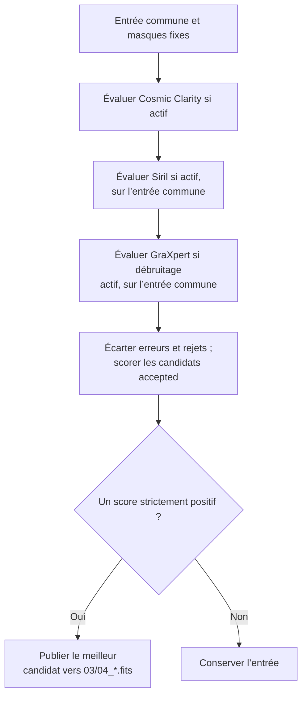

# Cosmic Clarity : moteur neuronal optionnel

[postProcess](README.md) · [Installation](../../INSTALLATION.md)

## Installation et lancement

Cosmic Clarity et Siril sont activés par défaut. Les étapes 03 (netteté) et
04 (débruitage) évaluent séquentiellement leurs moteurs actifs ; GraXpert peut
s’ajouter au débruitage lorsqu’il dispose de poids locaux valides. En mode fiable,
la meilleure sortie acceptée de score positif est retenue. Les étapes gradient et
photométrie, ainsi que les options d’activation, restent inchangées.

```bash
# Installation séparée des dépendances et des modèles.
bin/install_dependances.sh

# Traitement avec les réseaux, après installation.
bin/postProcess.sh image_RGB.fit rapports/ \
  --enable-clarity --photometry-object M20

# Revenir au mode Siril seul.
bin/postProcess.sh image_RGB.fit --disable-clarity --no-enable-graxpert
```

`bin/install_dependances.sh` sélectionne PyTorch CUDA sous Linux ou MPS sur
Apple Silicon, et précharge les modèles dont les six poids Cosmic Clarity,
environ 95 Mo au total. Les bibliothèques CUDA/PyTorch occupent plusieurs Go
supplémentaires. Les lanceurs de traitement utilisent ensuite le venv sans
installer ni mettre à jour de module.
Le moteur télécharge chaque poids nécessaire au moment de son premier chargement
s’il est absent ou corrompu. Les fichiers conformes sont réutilisés sans accès
réseau. Taille et SHA-256 sont vérifiés avant installation atomique ; une erreur
réseau ou d’intégrité échoue pour ce moteur et conserve le fichier précédent.
En mode fiable, les autres moteurs sont encore évalués ; l’installation explicite
et les exceptions de traitement en mode `legacy` restent bloquantes.
Le journal indique le téléchargement et le chemin utilisé. L’installation
explicite permet de précharger les six poids, notamment avant un usage hors ligne.
Le téléchargement automatique des poids n’installe pas PyTorch/CUDA.

Le dossier par défaut est `tmp/cache/models/cosmicclarity/` à la racine du projet, ignoré
par Git. `--cosmic-model-dir /chemin` change le dossier pour l'installation et
le traitement ; ce chemin doit aussi être fourni à l'installation si une
configuration de traitement utilise un dossier personnalisé. Le lanceur ne lit
pas le JSON de configuration pour installer les poids.

Le calcul hérite de `--compute-backend auto` : PyTorch choisit CUDA disponible,
puis MPS disponible sur Apple Silicon, CPU sinon, avant de charger les modèles.
Ce choix CPU automatique émet un WARNING précisant l'accélérateur indisponible ;
un CPU demandé explicitement reste silencieux sur ce point.
`--cosmic-device auto|cpu|cuda|mps` est
une surcharge facultative (`null` par défaut). CUDA ou MPS forcé indisponible reste
une erreur ; une panne en cours d'inférence ne déclenche pas de reprise CPU.
Siril 1.4 reste
nécessaire pour les mesures stellaires, même avec les réseaux. Le traitement
reste local, sans service distant ni entraînement.

Les sorties de `postProcess` sont regroupées par exécution sous le nom
`<image>_postprocess`. Quel que soit le moteur utilisé, on obtient par défaut :

- dossier d’étapes : `<image>_postprocess/`
- rapport global : `<image>_postprocess.json`
- FITS final : `<image>_postprocess.fits`

Le rapport et le FITS final restent au même niveau que ce dossier.

## Options

| Option | Défaut | Rôle |
|---|---|---|
| `--enable-clarity` | activé | Active le mode comparatif Cosmic Clarity + Siril |
| `--disable-clarity` | désactivé | Écarte Cosmic Clarity ; GraXpert peut rester actif en débruitage |
| `--cosmic-model-dir` | `<projet>/tmp/cache/models/cosmicclarity` | Poids locaux vérifiés |
| `--cosmic-device` | `null` (hérite du choix général `auto`) | Surcharge `auto`, `cuda`, `mps` ou `cpu` |
| `--cosmic-stellar-amount` | `0.5` | Mélange stellaire, entre 0 et 1 |
| `--cosmic-nonstellar-amount` | `0.5` | Mélange des structures diffuses, entre 0 et 1 |
| `--cosmic-nonstellar-radius` | `3.0` | Rayon en pixels, entre 1 et 8 |
| `--cosmic-denoise-amount` | `0.5` | Mélange du débruitage, entre 0 et 1 |
| `--cosmic-sharpen-mode` | `luminance` | Netteté sur Y ; `separate` traite R/V/B séparément |
| `--cosmic-denoise-mode` | `luminance` | `luminance`, `full` (Y + chrominance guidée), `separate` |
| `--cosmic-color-denoise-amount` | intensité du débruitage | Intensité Cb/Cr en mode `full`, de 0 à 1 |
| `--deconvolution-force-manual-matching` | `false` | Force les seuils manuels en mode `quality-mode legacy` |

Les options Python respectent CLI > configuration JSON > défauts et ne sont
sauvegardées qu'avec `-S`. `--disable-deconvolution` et `--disable-denoise`
s'appliquent aussi aux réseaux. Les seuils `--deconvolution-min-gain`,
`--deconvolution-max-noise`, `--deconvolution-max-rings`, les réglages
d'appariement, `--deconvolution-layer`, `--deconvolution-output` et
`--denoise-max-blur` restent actifs. Les paramètres du solveur Siril (`iterations`,
`psf-size`, `psf-method`, `alpha`, `step`, `adaptive`, etc.) et
`--denoise-modulation` n'agissent pas sur les réseaux.

En netteté (`03_deconvolution`), les seuils d’appariement stellaires sont
automatiques en mode `--quality-mode legacy` : ils sont estimés depuis le catalogue `before.tsv`
(rayon en fonction de la FWHM médiane et nombre minimal de correspondances).
Pour la netteté Cosmic Clarity, avec moins de 60 étoiles initiales, la fraction
minimale de 70 % reste bloquante. À partir de 60 étoiles, ce pourcentage devient
un seuil d’alerte : le nombre minimal reste obligatoire, puis des contrôles
de représentativité conditionnent l’évaluation de finesse et d’artefacts.
Le mode manuel forcé conserve son seuil de fraction bloquant ; le débruitage
conserve ses contrôles existants. Pour conserver des seuils fixes, fournir
les valeurs manuelles et ajouter `--deconvolution-force-manual-matching`.
Sans cette option de forçage, les valeurs manuelles d’appariement ne
remplacent pas le mode auto en `legacy`. En mode fiable, les seuils manuels
communs sont toujours utilisés : dix références, fraction 0,7 et rayon 1 pixel
par défaut, sans option de forçage nécessaire.

Une intensité nulle désactive le calcul correspondant, mais ne dispense pas des
contrôles d'acceptation : une netteté inchangée ne peut pas satisfaire le gain
minimal demandé. Le débruitage sans amélioration rend l'image précédente.

## Déroulé comparatif des étapes 03 et 04

Chaque étape de restauration évalue les moteurs actifs sur la même entrée :

1. **Cosmic Clarity** produit un candidat (`candidate.fits`) puis exécute
   exactement les mêmes mesures stellaires Siril que le pipeline classique.
2. **Siril** exécute l’algorithme natif correspondant (déconvolution ou
   débruitage) avec ses paramètres usuels.
3. **GraXpert** peut produire son candidat de débruitage natif ONNX, avec les
   mêmes contrôles ; ses règles d’activation sont décrites dans [GraXpert](graxpert.md).
4. Les rapports sont stockés dans `evaluations.cosmic_clarity`,
   `evaluations.siril` et, pour le débruitage actif, `evaluations.graxpert`,
   avec leurs statuts, mesures et motifs de rejet ou d’échec.
5. Le pipeline garde uniquement les candidats au statut `accepted`, calcule un
   score de sélection, puis retient le meilleur score strictement positif en
   mode fiable. Un candidat de score nul ne bat pas l’image d’entrée.
6. Si aucun candidat éligible ne bat l’identité :
   - étape 03 → statut `no_safe_improvement` ;
   - étape 04 → statut `rejected` ;
   et l’image d’entrée de l’étape est conservée.

Le journal de niveau `INFO` indique, pour la déconvolution et le débruitage,
le début puis le verdict de chaque évaluation active, y compris **GraXpert**.
Il affiche les motifs de rejet ou d’échec, les FWHM moyennes en pixels,
les gains de finesse moyen et médian apparié, la variation maximale du bruit
et la fraction maximale d’étoiles avec nouveaux anneaux lorsque ces mesures
sont disponibles. Chaque candidat accepté reçoit un score affiché (plus élevé
= meilleur). Une ligne `choix final` donne le moteur retenu, son score, le
nombre de candidats éligibles ; sans candidat sélectionnable,
elle indique que l’image d’entrée est conservée.

Un échec local du repli de déconvolution Siril, notamment une PSF Moffat
avec trop peu d’étoiles admissibles, conserve le candidat Cosmic Clarity dans
la sélection. Le rapport `evaluations.siril` garde les essais numérotés et
leurs erreurs ; si Siril n’a aucun essai accepté, son statut est
`no_safe_improvement`.



Ce schéma décrit le mode fiable de comparaison des moteurs d’une opération
isolée (`--no-restoration-compare-chains`). Chaque moteur actif reçoit la même
entrée ; les flèches entre évaluations décrivent leur ordre d’exécution,
pas une transmission de l’image produite au moteur suivant.
Siril est essayé seulement si `--restoration-siril` reste actif.
Les erreurs isolées sont auditées et ne
suppriment pas les autres candidats. Les [chaînes complètes](quality.md#chaînes-complètes)
ajoutent un contrôle final commun après les contrôles de chaque opération.

### Score de sélection utilisé

Le score départage les candidats déjà `accepted`. En mode fiable, il doit être
strictement positif pour battre l’identité, dont le score est zéro. Les formules
effectivement appliquées par `RestorationComparisonProcessor.score` sont :

- **Netteté (03)** :
  `2*mean_gain + 2*ratio_gain - 0.2*max(0, max_noise_ratio - 1) - 0.2*max_ring_fraction`.
  `mean_gain` vaut `1 - FWHM_moyenne_après/FWHM_moyenne_avant` ; `ratio_gain`
  vaut `1 - ratio_médian_apparié`. Un bruit UNKNOWN omet la pénalité de bruit
  sans valider cette mesure.
- **Débruitage (04), mode fiable** :
  `max(0, proven_gain) - 0.5*blur_penalty - 0.2*max_ring_fraction`.
  `proven_gain` est le minimum sur les canaux de `1 - borne_supérieure_95%`
  du ratio de bruit, mesuré sur les masques fixes. Une mesure UNKNOWN n’apporte
  aucun bonus. `blur_penalty` vaut le maximum de zéro et de la plus forte
  augmentation entre FWHM moyenne et ratio médian apparié.
- **Débruitage (04), mode legacy** : remplacer `max(0, proven_gain)` par
  `max(0, 1 - max_noise_ratio)`. Le ratio provient du diagnostic historique.
  Dans ce mode, les candidats acceptés restent sélectionnables même avec un
  score nul ou négatif.

Ces scores sont des heuristiques, sans garantie de fidélité astrophysique ;
voir [les critères communs](quality.md). En cas d’égalité stricte, l’ordre
d’évaluation départage : Cosmic Clarity, Siril, puis GraXpert en débruitage,
en ignorant les moteurs désactivés.

## Modules et algorithme

- `lib/cosmic_clarity/models.py` installe les fichiers décrits dans `models.json`
  via HTTPS, dans un fichier temporaire, puis vérifie taille et SHA-256 avant
  remplacement atomique. L'inférence vérifie aussi chaque fichier chargé.
- `color.py` fournit les conversions YCbCr et le filtre guidé des
  [modes couleur](cosmic-color.md), sans PyTorch.
- `network.py` contient les architectures compatibles avec les poids amont,
  avec connexions résiduelles et latérales. Les paramètres sont chargés
  strictement par PyTorch avec `weights_only=True`.
- `inference.py` fournit `CosmicClarityEngine.process(source, destination,
  operation, ...)`, écrit un candidat FITS distinct et retourne ses paramètres.
- `processors.py` fournit `CosmicClaritySharpenProcessor` et
  `CosmicClarityDenoiseProcessor`. Ces classes produisent le candidat, lancent
  les mesures Siril et décident si l'image peut être transmise à l'étape suivante.

Les données FITS mono ou RGB sont calculées en float32. Les entiers
sont divisés par leur maximum représentable, comme dans les contrôles Siril,
et la sortie float32 conserve cette échelle normalisée. Pour les autres données, si
nécessaire, une translation et une échelle communes placent les pixels dans
[0,1] ; elles sont inversées en sortie pour conserver l’échelle des flottants. Les fichiers
CFA, les dimensions incompatibles, les pixels non finis et les images constantes
sont refusés. Les autres HDU et les métadonnées sont conservés.

Les modes couleur suivent les scripts AI3 de l’auteur : **luminance** par
défaut pour la netteté et le débruitage en ligne de commande ; traitement des
canaux séparés en option ; débruitage `full` combinant réseau sur Y et filtre
guidé sur Cb/Cr. Le réseau reçoit une luminance ou un canal dupliqué trois fois,
comme chez l’auteur, et son premier canal de sortie est retenu. Le mode `full`
n’envoie pas le RGB complet au réseau.
Voir [modes couleur et prétraitement](cosmic-color.md) pour les conversions,
formules, paramètres, interfaces et limites de fidélité.

Le réseau travaille sur des tuiles de 256 × 256 pixels, avec recouvrement de
64 pixels. Une marge de 16 pixels est écartée sur chaque prédiction et les
recouvrements valides sont moyennés. Une bordure ajoutée à l'image assure la
couverture de tous ses pixels ; le dernier morceau est complété avant inférence.
Un seul lot est envoyé au GPU, et les réseaux sont chargés successivement.
La RAM contient néanmoins plusieurs tableaux à la taille de l'image.

La netteté applique d'abord le modèle stellaire, puis les modèles non stellaires
encadrant le rayon choisi parmi 1, 2, 4 et 8. Leurs sorties sont interpolées
linéairement. Chaque intensité `a` mélange l'entrée et la prédiction :
`sortie = (1 - a) entrée + a prédiction`. Le débruitage utilise le poids AI3.6.

Cette adaptation reprend les modes luminance/chrominance de la révision AI3
référencée, avec un rayon fixe et float32. Elle ne reproduit pas l’auto-PSF
locale, les interfaces graphiques ni toutes les variantes de l’application.
Les statistiques de bord et l’ordre de padding/étirement diffèrent encore de
l’amont ; il ne s’agit pas d’une reproduction pixel à pixel de l’exécutable.
Elle ne charge pas les modèles AI4 de Suite Pro.

## Contrôles et limites

Le mode par défaut `quality-mode reliable` partage les critères de correspondance
et les masques avec Siril et GraXpert. Voir [Qualité astrophotographique](quality.md)
pour le bruit fiable, UNKNOWN, les diagnostics de flux et la compétition des
chaînes. Les seuils automatiques particuliers de Clarity décrits ci-dessous
s’appliquent uniquement en mode `--quality-mode legacy`.


La netteté exige les mêmes mesures que la déconvolution Siril : étoiles appariées,
gain de finesse, bruit et anneaux acceptables. Le pipeline calcule ces mesures
pour Cosmic Clarity et Siril, puis choisit la sortie acceptée au score le plus
favorable. Si les deux sont rejetées, l’étape retourne `no_safe_improvement` et
conserve l’image d’entrée. Le débruitage applique la même logique comparative
avec `assess_denoising`, et GraXpert peut fournir un troisième candidat.
Si aucun candidat ne bat l’identité, l’image reçue est
conservée. En mode fiable, un incident technique écarte ce moteur avec un audit et permet
d’essayer les autres. Le mode `legacy` conserve les erreurs bloquantes historiques.

Les rapports `03_deconvolution.json` et `04_denoise.json` rassemblent les
évaluations et le choix final. Les rapports enfants Cosmic Clarity conservent
le périphérique, la version de PyTorch, les empreintes des poids utilisés,
les réglages, les mesures et les motifs de rejet. Chaque dossier de travail
conserve le candidat, le script et les catalogues de contrôle. Les rapports enfants ont un suffixe de moteur (`_cosmic_clarity`, `_siril`,
`_graxpert`) ; leur dossier `<rapport enfant>_work/` est recréé avant chaque
calcul avec un sous-dossier ordonné `001/`.
Une ancienne sortie acceptée n'est pas remplacée par un candidat rejeté.

Ces contrôles ne prouvent pas la conservation de structures diffuses ou des flux
photométriques. La validation sur des FITS astronomiques avec Siril et inspection
visuelle reste nécessaire avant de préférer ce moteur au traitement classique.

## Vérification reproductible

Tests de non-régression (les poids manquants sont téléchargés si CUDA est disponible) :

```bash
.venv/bin/python -m pytest -q tests/test_cosmic_clarity.py tests/test_cosmic_inference.py
```

Les tests d’inférence sont ignorés si PyTorch n’est pas installé. Le test des
vrais poids est exécuté automatiquement dans la non-régression lorsque CUDA
est disponible ; il est ignoré avec une raison explicite sinon. Il charge les
six poids sur CUDA puis traite un FITS synthétique avec les deux opérations.
Un modèle manquant est téléchargé ; une erreur réseau, de chargement ou de
calcul fait échouer le test. Pour le lancer seul :

```bash
.venv/bin/python -m pytest -q tests/test_cosmic_inference.py::test_real_weights_cuda
```

`COSMIC_MODEL_DIR` peut désigner un autre dossier pour ce test. Celui-ci vérifie
la compatibilité des checkpoints, les dimensions et la finitude des sorties,
ainsi que la préservation de l'entrée ; il ne constitue pas un test de qualité
astronomique ni une validation de bout en bout avec Siril.

## Provenance

Architectures et pré/post-traitements adaptés du dépôt
[setiastro/cosmicclarity](https://github.com/setiastro/cosmicclarity/tree/423acc442724872ff6d81011962a8cbf5744a7f7),
commit `423acc442724872ff6d81011962a8cbf5744a7f7`. La licence MIT de Franklin
Marek est conservée dans `lib/cosmic_clarity/LICENSE`. Les poids proviennent de
la [publication Linux officielle](https://github.com/setiastro/cosmicclarity/releases/tag/Linux),
avec des empreintes figées dans le manifeste du projet. Les scripts d'interface
Siril, sous une autre licence, ne sont pas incorporés.

<a id="matching-representation"></a>

## Représentativité de l’appariement pour la netteté

En mode `--quality-mode legacy`, le rayon automatique reste `clip(0.35 × FWHM_médiane, 0.8, 2.0)` pixels.
Le nombre minimal reste `clip(round(0.30 × N), 3, 30)`, où N est le nombre
d’étoiles valides avant traitement. Aucun assouplissement du nombre minimal
n’est appliqué au grand catalogue.

Pour N ≥ 60, les étoiles initiales sont réparties en quatre quadrants autour
des médianes X/Y, et en quatre classes définies par les quartiles de leur flux
relatif. Le classement utilise `A × FWHMx × FWHMy`, proportionnel au flux d’un
profil gaussien ; A est l’amplitude du catalogue Siril, pas une magnitude.
Seules les valeurs avant traitement servent au classement pour éviter que la
restauration change la classe de référence.

Chaque groupe comportant au moins dix étoiles doit conserver un taux
d’appariement au moins égal à la moitié du maximum entre taux global et fraction
minimale demandée. Un groupe perdant toutes
ses étoiles échoue donc. Les groupes plus petits sont consignés sans verdict
individuel. Une amplitude absente, non finie ou non positive empêche de valider
le contrôle de flux. Ces bornes sont des heuristiques explicites, sans calibration
statistique générale ; elles ne prouvent pas la conservation photométrique,
ne vérifient pas les distributions conjointes position/flux, et ne remplacent
pas l’inspection visuelle du candidat.

Le JSON expose `comparison.warnings`, `comparison.representation.groups`, les
taux par groupe et les motifs `underrepresented_spatial_group_*`,
`underrepresented_brightness_group_*` ou `missing_valid_brightness`.
Le statut `unrepresentative_matches` bloque le candidat avant sa sélection.
Le journal affiche le taux global lorsqu’il est inférieur à 70 %, ainsi que le
verdict de représentativité. Les autres critères de finesse, bruit, rondeur et
anneaux restent obligatoires après validation de l’appariement.

### Lecture des motifs dans le journal

Les lignes d’appariement affichent le nombre retrouvé et initial, la proportion,
le minimum de correspondances, le rayon et le caractère bloquant ou non de la
fraction. Chaque zone spatiale et classe de flux affiche ses effectifs, son taux,
le taux minimal et son verdict. Les classes de flux sont numérotées de 0 (plus
faibles) à 3 (plus fortes).

Les gains moyen et médian sont affichés séparément avec quatre décimales,
leur seuil et le verdict : un gain moyen de 1,9942 % échoue au minimum de
2,0000 %, même si le gain médian de 2,0010 % passe. Les contrôles de rondeur,
bruit et anneaux affichent également valeur et limite. Un rejet global Siril
mentionne les essais déjà évalués, sans annoncer que leur finesse n’a pas été
mesurée. Le détail brut du verdict reste disponible au niveau DEBUG et en JSON.

La [mesure locale aux positions initiales](reference-stars.md) remplace par défaut
la dépendance à une nouvelle détection après traitement. Les contrôles de
représentativité portent alors sur les références fiables sélectionnées sur
l’image d’entrée ; une mesure candidate échouée reste comptée dans leur taux
de rétention.

Les classes Cosmic Clarity produisent uniquement leur candidat neuronal.
La comparaison avec Siril relève des [orchestrateurs de restauration](restoration.md),
sans choix de moteur dans la séquence de post-traitement.
