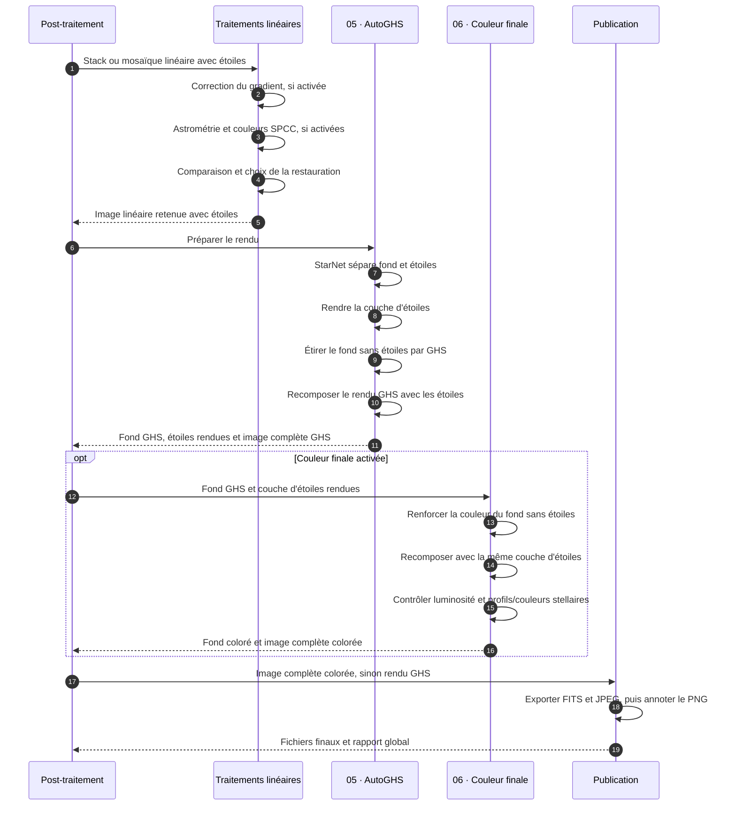

# Principe du post-traitement

[postProcess](README.md) › Présentation › Principe du post-traitement

## 1. Vue d'ensemble

postProcess reçoit le stack ou la mosaïque linéaire avec étoiles. Les étapes
actives corrigent le gradient, étalonnent les couleurs et sélectionnent une
restauration. AutoGHS sépare ensuite le fond et les étoiles pour adapter leur
rendu séparément. La couleur finale renforce le fond étiré avant de produire
une nouvelle image complète avec les étoiles, puis viennent les exports et
l'annotation.

Ce parcours est commun au lancement autonome et à l'enchaînement depuis
lightProcess. Le [manuel d'utilisation](README.md#manuel-dutilisation) décrit
les commandes ; le [pipeline commun](pipeline.md) détaille l'orchestration,
les paramètres et les reprises. La [couleur finale](final-color.md) décrit
les réglages et les contrôles du renforcement chromatique.

## 2. Diagramme de séquence

Le diagramme décrit le parcours avec AutoGHS actif, commun à lightProcess et
postProcess. Les corrections linéaires désactivées transmettent l'image reçue.
Les numéros `05` et `06` désignent les étapes AutoGHS et couleur ; dans le plan
lightProcess, leurs fichiers sont sous `05_autoghs/` et `06_color/`.

## 3. Fond sans étoiles et image finale

**La saturation finale s'applique au fond sans étoiles étiré par GHS.** Ce fond
contient le ciel et les objets étendus, comme les galaxies et les nébuleuses.
La couche d'étoiles suit son propre rendu dans AutoGHS. Elle est ensuite
réutilisée pour la recomposition couleur, sans nouvelle passe de saturation
sur ses pixels. Cette séparation permet de renforcer les couleurs du diffus
tout en contrôlant la couleur et le profil des étoiles après fusion.
Le fond coloré et les étoiles sont recomposés à partir des deux couches
conservées ; l'image complète GHS n'est pas saturée une seconde fois.
Les contrôles de fusion peuvent diminuer la force couleur avant publication.

Deux recompositions figurent donc dans le parcours : AutoGHS conserve son
rendu complet, puis la passe couleur produit le rendu complet coloré depuis
le fond GHS et les mêmes étoiles. Si la couleur est désactivée, le premier
rendu est exporté. Sans AutoGHS, la passe couleur implicite est également
omise et la sortie reste linéaire. `--autoghs-only` reprend à la préparation du
rendu ; `--color-only` réutilise directement les deux couches existantes avant
les exports et l'annotation.

Dans `06_color/color.json`, `image_path` désigne le fond GHS utilisé en entrée,
`output_starless_image` le fond coloré et `output_image` l'image recomposée
avec étoiles. Un fichier nommé `*_starless_ghs_range_color_final.fits` peut
donc contenir les étoiles : son nom reprend celui du fond d'entrée. Dans le
parcours complet, son en-tête FITS porte `SPROLE=WITHSTARS`, tandis que le fond
coloré porte `SPROLE=STARLESS`. Voir les [sorties et leur provenance](final-color.md#3-entrées-provenance-et-sorties).

